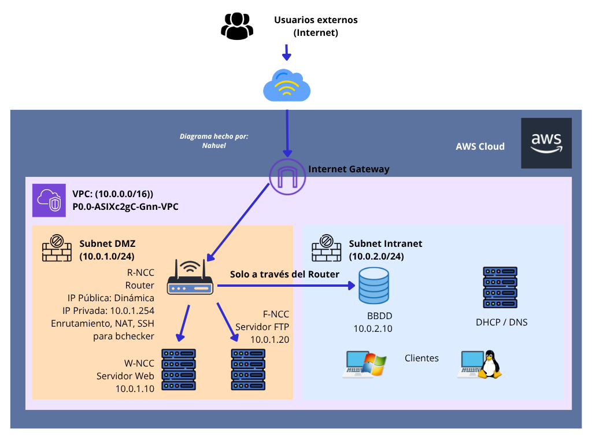

# Projecte P0.0-ASIXc2gC · Infraestructura Multicapa a AWS Cloud

Documentació completa del projecte d'ASIX: estudi previ, arquitectura de xarxa, base de dades i MVP web, pla de riscos i annex tècnic amb tots els comandaments utilitzats (Sprint 1 i Sprint 2).

**Autor:** Nahuel

---

<a id="index"></a>
## Índex

- [1. Estudi previ de tecnologies i anàlisi de mercat (RA1)](#estudi-previ)
  - [1.1 Introducció](#intro)
  - [1.2 Comparativa de tecnologies de virtualització](#comparativa)
  - [1.3 Justificació de la solució seleccionada](#justificacio)
- [2. Arquitectura de xarxa i infraestructura (RA2)](#arquitectura)
  - [2.1 Esquema visual de la solució](#esquema)
  - [2.2 Disseny del xarxejament (VPC)](#vpc)
  - [2.3 Matriu d'equips i IPs](#equips)
  - [2.4 Seguretat i usuaris](#seguretat-usuaris)
- [3. Desplegament de base de dades i MVP web (Sprint 2)](#bbdd-mvp)
  - [3.1 Topologia de xarxa i infraestructura cloud](#topologia)
  - [3.2 Configuració de MySQL i ingesta del dataset (B-NCC)](#mysql)
    - [3.2.1 Instal·lació offline i binding de xarxa](#mysql-install)
    - [3.2.2 Processament del dataset (OpenData Barcelona)](#dataset)
    - [3.2.3 Estructura de la base de dades i importació SQL](#sql)
  - [3.3 Desplegament de l'aplicació web MVP (R-NCC)](#web-mvp)
  - [3.4 Matriu de proves i verificació](#proves)
- [4. Pla de prevenció de riscos i contingència (RA3)](#riscos)
  - [4.1 Prevenció de riscos laborals (PRL)](#prl)
  - [4.2 Riscos tècnics i mitigació](#riscos-tecnics)
- [5. Annex tècnic: registre de comandaments i configuracions](#annex)
  - [5.1 Sprint 1](#annex-s1)
    - [5.1.1 Clonat i identitat de Git](#annex-s1-git)
    - [5.1.2 Generació de la clau SSH](#annex-s1-ssh)
    - [5.1.3 Estructura de documentació](#annex-s1-estructura)
    - [5.1.4 Gestió d'imatges i pujada a GitHub](#annex-s1-push)
    - [5.1.5 Infraestructura AWS (VPC i xarxa)](#annex-s1-aws)
    - [5.1.6 Script d'inicialització (User Data)](#annex-s1-userdata)
    - [5.1.7 Administració i comprovació del servei](#annex-s1-admin)
  - [5.2 Sprint 2](#annex-s2)
    - [5.2.1 Connexió inicial i preparació de l'entorn](#annex-s2-ssh)
    - [5.2.2 Instal·lació offline de MySQL Server a B-NCC](#annex-s2-mysql)
    - [5.2.3 Configuració de xarxa i seguretat a MySQL](#annex-s2-config)
    - [5.2.4 Neteja i conversió del dataset CSV](#annex-s2-csv)
    - [5.2.5 Creació de la base de dades i càrrega de dades](#annex-s2-bbdd)
    - [5.2.6 Desplegament del servidor web MVP](#annex-s2-web)

---

<a id="estudi-previ"></a>
## 1. Estudi previ de tecnologies i anàlisi de mercat (RA1)

[⬆ Tornar a l'índex](#index)

<a id="intro"></a>
### 1.1 Introducció

[⬆ Tornar a l'índex](#index)

L'objectiu d'aquest projecte és dissenyar i desplegar una infraestructura multicapa segura sobre AWS Cloud per a l'assignatura d'ASIX.

<a id="comparativa"></a>
### 1.2 Comparativa de tecnologies de virtualització

[⬆ Tornar a l'índex](#index)

| Criteri | On-Premises (VirtualBox) | AWS Cloud (VPC + EC2) |
|---|---|---|
| Cost inicial | Alt (requereix maquinari local de gran capacitat) | Zero (pagament per ús / AWS Academy) |
| Escalabilitat | Limitada per la RAM i CPU físiques | Quasi il·limitada, instantàniament |
| Aïllament de xarxa | Complex de simular amb interfícies virtuals | Nativa mitjançant VPC, Subnets i Security Groups |
| Disponibilitat | Depèn de l'host local | Alta disponibilitat multizona |

<a id="justificacio"></a>
### 1.3 Justificació de la solució seleccionada

[⬆ Tornar a l'índex](#index)

S'ha seleccionat AWS Cloud utilitzant instàncies EC2 Ubuntu 24.04 LTS. Aquesta opció permet simular la topologia física d'una xarxa d'empresa real (DMZ + Intranet + NAT), garantint la seguretat per disseny mitjançant Grups de Seguretat i Taules d'Enrutament separades.

---

<a id="arquitectura"></a>
## 2. Arquitectura de xarxa i infraestructura (RA2)

[⬆ Tornar a l'índex](#index)

<a id="esquema"></a>
### 2.1 Esquema visual de la solució

[⬆ Tornar a l'índex](#index)

Fes clic sobre la imatge per veure-la a mida completa.

[](docs/img/diagrama-arquitectura.png)

<a id="vpc"></a>
### 2.2 Disseny del xarxejament (VPC)

[⬆ Tornar a l'índex](#index)

- **CIDR principal de la VPC:** `10.0.0.0/16`
- **Subxarxa DMZ (pública):** `10.0.1.0/24` (conté el router R-NCC, que també fa de servidor web en l'MVP)
- **Subxarxa Intranet (privada):** `10.0.2.0/24` (conté la BBDD B-NCC, serveis interns i clients)

<a id="equips"></a>
### 2.3 Matriu d'equips i IPs

[⬆ Tornar a l'índex](#index)

| Hostname | Rol / Servei | Subxarxa | IP privada | IP pública |
|---|---|---|---|---|
| R-NCC | Router / Gateway / SSH / Servidor web (MVP) | DMZ | 10.0.1.80 | Sí (dinàmica) |
| W-NCC | Servidor web / Demo MVP | DMZ | 10.0.1.10 | Opcional |
| B-NCC | BBDD MySQL | Intranet | 10.0.2.192 | No |
| F-NCC | Servidor FTP | DMZ | 10.0.1.20 | No |

<a id="seguretat-usuaris"></a>
### 2.4 Seguretat i usuaris

[⬆ Tornar a l'índex](#index)

Tots els equips disposen de l'usuari d'administració estàndard del projecte:

- **Usuari:** `bchecker`
- **Password:** `bchecker121`

---

<a id="bbdd-mvp"></a>
## 3. Desplegament de base de dades i MVP web (Sprint 2)

[⬆ Tornar a l'índex](#index)

<a id="topologia"></a>
### 3.1 Topologia de xarxa i infraestructura cloud

[⬆ Tornar a l'índex](#index)

Dins de la VPC `P0.0-ASIXc2gC-Gnn-VPC`, s'ha configurat una arquitectura en dues capes per tal de garantir el seccionament de la xarxa:

**Instància `R-NCC` (DMZ):**

- IP privada: `10.0.1.80` (Subnet-DMZ)
- IP pública dinàmica assignada per AWS EC2
- Serveis: Apache2, mòdul PHP 8.x, encaminament de xarxa i accés SSH
- Ports oberts: `22` (SSH), `80` (HTTP)

**Instància `B-NCC` (Intranet):**

- IP privada: `10.0.2.192` (Subnet-Intranet)
- Sense IP pública (aïllada completament d'Internet)
- Serveis: MySQL Server 8.x
- Ports oberts: `22` (només des de la subxarxa DMZ `10.0.1.0/24`), `3306` (MySQL des de `10.0.1.0/24`)

<a id="mysql"></a>
### 3.2 Configuració de MySQL i ingesta del dataset (B-NCC)

[⬆ Tornar a l'índex](#index)

<a id="mysql-install"></a>
#### 3.2.1 Instal·lació offline i binding de xarxa

[⬆ Tornar a l'índex](#index)

A causa de l'aïllament de la subxarxa Intranet, els paquets `.deb` es van descarregar des de `R-NCC` i es van transferir mitjançant SCP per ser instal·lats amb `dpkg`:

```bash
sudo dpkg -i /home/bchecker/mysql_pkgs/*.deb
```

Es va configurar el fitxer `/etc/mysql/mysql.conf.d/mysqld.cnf` per permetre la connexió remota des de la DMZ i l'ús de fitxers locals:

```ini
bind-address = 0.0.0.0
local_infile = 1
```

<a id="dataset"></a>
#### 3.2.2 Processament del dataset (OpenData Barcelona)

[⬆ Tornar a l'índex](#index)

El fitxer `equipaments_educacio.csv` (2.709 registres) presentava una codificació original UTF-16LE amb caràcters especials. Es va processar i netejar a UTF-8 pur mitjançant `iconv` i `sed`:

```bash
iconv -f UTF-16LE -t UTF-8 /home/bchecker/equipaments_educacio.csv | tr -d '\r' | sed '1s/^\xEF\xBB\xBF//' > /home/bchecker/equipaments_utf8.csv
```

<a id="sql"></a>
#### 3.2.3 Estructura de la base de dades i importació SQL

[⬆ Tornar a l'índex](#index)

S'ha creat la base de dades `barcelona_edu` i la taula `equipaments` amb el següent script SQL:

```sql
CREATE DATABASE IF NOT EXISTS barcelona_edu;
CREATE USER IF NOT EXISTS 'bchecker'@'%' IDENTIFIED BY 'bchecker121';
GRANT ALL PRIVILEGES ON barcelona_edu.* TO 'bchecker'@'%';
FLUSH PRIVILEGES;

USE barcelona_edu;
SET GLOBAL local_infile = 1;

CREATE TABLE IF NOT EXISTS equipaments (
    id INT AUTO_INCREMENT PRIMARY KEY,
    codi_equipament VARCHAR(50),
    nom VARCHAR(255),
    seccio VARCHAR(100),
    nom_districte VARCHAR(100),
    nom_barri VARCHAR(100),
    adreca VARCHAR(255),
    telefon VARCHAR(50)
) CHARACTER SET utf8mb4 COLLATE utf8mb4_unicode_ci;

LOAD DATA LOCAL INFILE '/home/bchecker/equipaments_utf8.csv'
INTO TABLE equipaments
CHARACTER SET utf8mb4
FIELDS TERMINATED BY ',' ENCLOSED BY '"' LINES TERMINATED BY '\n'
IGNORE 1 LINES
(
  @col1, @name, @col3, @col4, @col5, @col6, @col7, @col8, @col9,
  @street, @col11, @col12, @col13, @neigh, @col15, @district,
  @col17, @col18, @col19, @col20, @col21, @col22, @col23, @col24,
  @phone, @col26, @col27, @col28, @sec, @col30, @col31, @col32,
  @col33, @col34, @col35, @col36, @col37, @col38, @col39, @col40
)
SET
  codi_equipament = @col1,
  nom = NULLIF(@name, ''),
  seccio = NULLIF(@sec, ''),
  nom_districte = NULLIF(@district, ''),
  nom_barri = NULLIF(@neigh, ''),
  adreca = NULLIF(@street, ''),
  telefon = NULLIF(@phone, '');
```

<a id="web-mvp"></a>
### 3.3 Desplegament de l'aplicació web MVP (R-NCC)

[⬆ Tornar a l'índex](#index)

A la instància `R-NCC` s'ha instal·lat el servidor web Apache2 amb el mòdul de PHP:

```bash
sudo apt update && sudo apt install -y apache2 php libapache2-mod-php php-mysql
```

Es va crear l'aplicació PHP `/var/www/html/index.php`, que consulta directament la base de dades remota a `10.0.2.192`:

```php
<?php
$host = '10.0.2.192';
$user = 'bchecker';
$pass = 'bchecker121';
$db   = 'barcelona_edu';

$conn = new mysqli($host, $user, $pass, $db);

if ($conn->connect_error) {
    die("<h1>Error de connexió:</h1> " . $conn->connect_error);
}

$sql = "SELECT nom, nom_districte, adreca FROM equipaments WHERE nom IS NOT NULL LIMIT 20";
$result = $conn->query($sql);
?>

<!DOCTYPE html>
<html lang="ca">
<head>
    <meta charset="UTF-8">
    <title>MVP Equipaments Educació BCN</title>
    <style>
        body { font-family: Arial, sans-serif; margin: 30px; background-color: #f4f4f9; }
        h1 { color: #333; }
        table { width: 100%; border-collapse: collapse; background: #fff; }
        th, td { padding: 12px; border: 1px solid #ccc; text-align: left; }
        th { background-color: #0056b3; color: white; }
        tr:nth-child(even) { background-color: #f9f9f9; }
    </style>
</head>
<body>
    <h1>Equipaments d'Educació de Barcelona (Sprint 2 ASIX)</h1>
    <p><strong>Estat connexió BBDD:</strong> OK (Connectat a B-NCC 10.0.2.192)</p>
    <table>
        <tr>
            <th>Nom Escola</th>
            <th>Districte</th>
            <th>Adreça</th>
        </tr>
        <?php while($row = $result->fetch_assoc()): ?>
        <tr>
            <td><?php echo htmlspecialchars($row['nom']); ?></td>
            <td><?php echo htmlspecialchars($row['nom_districte']); ?></td>
            <td><?php echo htmlspecialchars($row['adreca']); ?></td>
        </tr>
        <?php endwhile; ?>
    </table>
</body>
</html>
```

<a id="proves"></a>
### 3.4 Matriu de proves i verificació

[⬆ Tornar a l'índex](#index)

| Prova | Comanda / Endpoint | Resultat esperat | Estat |
|---|---|---|---|
| Accés SSH Intranet | `ssh bchecker@10.0.2.192` des de R-NCC | Accés correcte via contrasenya | PASS |
| Connexió MySQL | `mysql -h 10.0.2.192 -u bchecker -p` | Connexió establerta correctament | PASS |
| Integritat de dades | `SELECT COUNT(*) FROM equipaments;` | 2.709 registres importats | PASS |
| Renderitzat web | `http://<IP_PUBLICA_R_NCC>` | Visualització de la taula HTML amb dades reals | PASS |

---

<a id="riscos"></a>
## 4. Pla de prevenció de riscos i contingència (RA3)

[⬆ Tornar a l'índex](#index)

<a id="prl"></a>
### 4.1 Prevenció de riscos laborals (PRL)

[⬆ Tornar a l'índex](#index)

1. **Ergonomia digital:** ajust de la il·luminació i de la posició de la pantalla durant les sessions de configuració cloud.
2. **Pauses mecano-estàtiques:** pauses de 5 minuts per cada hora de treball d'administració de sistemes.

<a id="riscos-tecnics"></a>
### 4.2 Riscos tècnics i mitigació

[⬆ Tornar a l'índex](#index)

**Esgotament del saldo de 50 $ d'AWS**

- Ús d'instàncies de baix consum (`t2.micro`).
- Apagat dels equips en períodes d'inactivitat.

**Pèrdua d'accés remot per SSH**

Tota l'administració de la infraestructura es fa per SSH amb l'usuari `bchecker`. B-NCC no té IP pública i només s'hi pot arribar saltant des de R-NCC, de manera que perdre l'accés SSH a R-NCC deixaria tota la infraestructura inaccessible. Les causes més probables són: pèrdua o corrupció de la clau privada, oblit o canvi de la contrasenya, canvi de la IP pública dinàmica de R-NCC en aturar i tornar a iniciar la instància, o un Security Group mal modificat.

Mesures de mitigació:

- **Doble mètode d'autenticació:** l'usuari `bchecker` pot entrar amb clau SSH ed25519 (mètode principal) o amb contrasenya (mètode alternatiu si la clau falla). Si un dels dos es perd, l'altre continua funcionant.
- **Còpia de seguretat de la clau privada:** la clau `~/.ssh/id_ed25519_bchecker` es guarda en un lloc segur fora del repositori i mai es puja a GitHub.
- **Control de la IP pública:** després de reiniciar R-NCC es consulta la nova IP pública a la consola d'AWS. Si cal una IP fixa, es pot assignar una Elastic IP.
- **Security Group estable:** el port `22` es manté obert al SG de la DMZ, i B-NCC només l'accepta des de la subxarxa DMZ (`10.0.1.0/24`).
- **Via de recuperació:** si es perden els dos mètodes, es pot recuperar l'accés des de la consola d'AWS (EC2 Instance Connect) o recreant la instància amb el script de User Data (vegeu l'[annex 5.1.6](#annex-s1-userdata)), que torna a deixar l'usuari `bchecker` i l'SSH per contrasenya preparats.

---

<a id="annex"></a>
## 5. Annex tècnic: registre de comandaments i configuracions

[⬆ Tornar a l'índex](#index)

Aquest annex recull, en ordre cronològic, els comandaments i configuracions executats des del terminal local i els servidors d'AWS durant el Sprint 1 i el Sprint 2.

<a id="annex-s1"></a>
### 5.1 Sprint 1

[⬆ Tornar a l'índex](#index)

Desplegament de la infraestructura base i de l'MVP inicial.

<a id="annex-s1-git"></a>
#### 5.1.1 Clonat i identitat de Git

[⬆ Tornar a l'índex](#index)

Configuració global de les credencials de Git per a la signatura dels commits:

```bash
# Anar al directori personal i clonar el repositori
cd ~
git clone https://github.com/<EL_TEU_USUARI_GITHUB>/proyectoasix2cnahuel.git
cd proyectoasix2cnahuel

# Establir nom i correu de la identitat
git config --global user.email "el_teu_correu@gmail.com"
git config --global user.name "ElTeuUsuariGitHub"
```

<a id="annex-s1-ssh"></a>
#### 5.1.2 Generació de la clau SSH

[⬆ Tornar a l'índex](#index)

Generació del parell de claus ed25519 per a l'autenticació del projecte:

```bash
# Generar la clau SSH sense contrasenya
ssh-keygen -t ed25519 -C "bchecker@proyectoasix2cnahuel" -f ~/.ssh/id_ed25519_bchecker -N ""

# Visualitzar la clau pública per afegir-la a GitHub
cat ~/.ssh/id_ed25519_bchecker.pub
```

<a id="annex-s1-estructura"></a>
#### 5.1.3 Estructura de documentació

[⬆ Tornar a l'índex](#index)

Creació de carpetes i fitxers inicials de la documentació en Markdown:

```bash
# Creació de directoris
mkdir -p docs/img scripts

# Creació dels fitxers de documentació inicials
touch docs/01-estudi-previ.md
touch docs/02-arquitectura-xarxa.md
touch docs/04-seguretat-i-riscos.md
```

> **Nota:** posteriorment aquests documents es van unificar en aquest `README.md`.

<a id="annex-s1-push"></a>
#### 5.1.4 Gestió d'imatges i pujada a GitHub

[⬆ Tornar a l'índex](#index)

Comandaments utilitzats per moure el diagrama fet amb Canva, afegir els canvis i pujar-los al repositori mitjançant un Personal Access Token (PAT):

```bash
# Moure la imatge del diagrama des de la carpeta de descàrregues
mv ~/Baixades/diagrama.png ~/proyectoasix2cnahuel/docs/img/diagrama-arquitectura.png

# Afegir fitxers a l'àrea de preparació (staging)
git add .

# Fer el commit
git commit -m "docs: afegir estudi previ, arquitectura de xarxa i pla de riscos (Sprint 1)"

# Enviar els canvis a la branca principal de GitHub
git push origin main
```

<a id="annex-s1-aws"></a>
#### 5.1.5 Infraestructura AWS (VPC i xarxa)

[⬆ Tornar a l'índex](#index)

Paràmetres utilitzats durant la configuració manual a la consola d'AWS:

- **VPC:** `P0.0-ASIXc2gC-Gnn-VPC`, IPv4 CIDR `10.0.0.0/16`
- **Subxarxes (a `us-east-1a`):**
  - DMZ (pública): `Subnet-DMZ`, CIDR `10.0.1.0/24`
  - Intranet (privada): `Subnet-Intranet`, CIDR `10.0.2.0/24`
- **Internet Gateway:** `IGW-P0.0`, associat a la VPC
- **Taula d'enrutament:** `RT-DMZ-Public`, amb la ruta `0.0.0.0/0` cap a `IGW-P0.0`, associada a `Subnet-DMZ`
- **Grup de seguretat `SG-DMZ-ASIX`:** entrades permeses pel port 22 (SSH), pel port 80 (HTTP) i All ICMP IPv4 (ping) des de `0.0.0.0/0`

<a id="annex-s1-userdata"></a>
#### 5.1.6 Script d'inicialització (User Data)

[⬆ Tornar a l'índex](#index)

Script bash injectat en el moment de crear la instància EC2 Ubuntu 24.04 LTS (`t2.micro`):

```bash
#!/bin/bash
# 1. Configuració de hostname i activació d'IP Forwarding (funció de router)
hostnamectl set-hostname R-NCC
echo "net.ipv4.ip_forward=1" >> /etc/sysctl.conf
sysctl -p

# 2. Creació de l'usuari estàndard obligatori bchecker
useradd -m -s /bin/bash bchecker
echo "bchecker:bchecker121" | chpasswd
usermod -aG sudo bchecker

# 3. Activació de l'autenticació SSH per contrasenya
sed -i 's/PasswordAuthentication no/PasswordAuthentication yes/g' /etc/ssh/sshd_config /etc/ssh/sshd_config.d/*
systemctl restart sshd

# 4. Instal·lació de serveis i eines de xarxa
apt-get update -y
apt-get install -y apache2 net-tools

# 5. Desplegament del portal HTML de l'MVP (Sprint 1)
cat << 'EOF' > /var/www/html/index.html
<!DOCTYPE html>
<html lang="ca">
<head>
    <meta charset="UTF-8">
    <title>MVP Sprint 1 - Projecte ASIX</title>
    <style>
        body { font-family: Arial, sans-serif; background-color: #f4f4f9; padding: 40px; text-align: center; }
        .card { background: white; padding: 30px; border-radius: 10px; box-shadow: 0 4px 8px rgba(0,0,0,0.1); max-width: 600px; margin: auto; }
        h1 { color: #003366; }
        .status { color: green; font-weight: bold; }
    </style>
</head>
<body>
    <div class="card">
        <h1>Projecte P0.0-ASIXc2gC - Sprint 1 MVP</h1>
        <p><strong>Hostname:</strong> R-NCC / W-NCC (Router & Web Server)</p>
        <p><strong>Estat de la xarxa:</strong> <span class="status">VPC DMZ / Intranet Desplegada amb Èxit</span></p>
        <p><strong>Usuari actiu:</strong> bchecker</p>
        <hr>
        <p>Projecte organitzat i gestionat en GitHub i ProofHub.</p>
    </div>
</body>
</html>
EOF

systemctl restart apache2
```

<a id="annex-s1-admin"></a>
#### 5.1.7 Administració i comprovació del servei

[⬆ Tornar a l'índex](#index)

Comandaments utilitzats des del terminal per accedir remotament i validar l'estat dels serveis:

```bash
# Accés per SSH amb l'usuari bchecker a la IP pública
ssh bchecker@<IP_PUBLICA_AWS>

# Comprovar l'estat del servidor web Apache
sudo systemctl status apache2

# Reiniciar el servei web en cas de fallada
sudo systemctl restart apache2

# Validar el contingut del fitxer index.html creat
cat /var/www/html/index.html
```

<a id="annex-s2"></a>
### 5.2 Sprint 2

[⬆ Tornar a l'índex](#index)

Desplegament de la base de dades MySQL i de l'MVP web.

<a id="annex-s2-ssh"></a>
#### 5.2.1 Connexió inicial i preparació de l'entorn

[⬆ Tornar a l'índex](#index)

Connexió per SSH des de la màquina física a la màquina router/bastió de la DMZ i salt posterior cap a la Intranet:

```bash
ssh bchecker@<IP_PUBLICA_R_NCC>

# Salt per SSH des de R-NCC a B-NCC (Intranet)
ssh bchecker@10.0.2.192
```

<a id="annex-s2-mysql"></a>
#### 5.2.2 Instal·lació offline de MySQL Server a B-NCC

[⬆ Tornar a l'índex](#index)

Degut a l'aïllament de la subxarxa Intranet (`Subnet-Intranet`, `10.0.2.0/24`), els paquets es van descarregar a R-NCC i es van enviar a B-NCC per SCP:

```bash
# Executat a R-NCC:
mkdir -p ~/mysql_pkgs && cd ~/mysql_pkgs
sudo apt-get install --download-only -y mysql-server
cp /var/cache/apt/archives/*.deb ~/mysql_pkgs/
scp -r ~/mysql_pkgs bchecker@10.0.2.192:/home/bchecker/

# Executat a B-NCC:
sudo dpkg -i /home/bchecker/mysql_pkgs/mysql-common_*.deb
sudo dpkg -i /home/bchecker/mysql_pkgs/*.deb
sudo systemctl start mysql
sudo systemctl enable mysql
```

<a id="annex-s2-config"></a>
#### 5.2.3 Configuració de xarxa i seguretat a MySQL

[⬆ Tornar a l'índex](#index)

Modificació de la directiva d'escolta per admetre peticions des de la DMZ (`10.0.1.80`) i activació de la càrrega local de fitxers:

```bash
# Permetre binding global (0.0.0.0)
sudo sed -i 's/127.0.0.1/0.0.0.0/g' /etc/mysql/mysql.conf.d/mysqld.cnf

# Habilitar local_infile al servidor i al client
echo -e "\n[mysqld]\nlocal_infile=1\n\n[client]\nlocal_infile=1" | sudo tee -a /etc/mysql/mysql.conf.d/mysqld.cnf

# Reiniciar el servei
sudo systemctl restart mysql
```

<a id="annex-s2-csv"></a>
#### 5.2.4 Neteja i conversió del dataset CSV

[⬆ Tornar a l'índex](#index)

Resolució de la incidència de codificació UTF-16LE i eliminació de la marca BOM:

```bash
# Conversió de UTF-16LE a UTF-8 net, sense BOM ni salt de línia de Windows (\r)
iconv -f UTF-16LE -t UTF-8 /home/bchecker/equipaments_educacio.csv | tr -d '\r' | sed '1s/^\xEF\xBB\xBF//' > /home/bchecker/equipaments_utf8.csv

# Verificació de la capçalera
head -n 2 /home/bchecker/equipaments_utf8.csv
```

<a id="annex-s2-bbdd"></a>
#### 5.2.5 Creació de la base de dades i càrrega de dades

[⬆ Tornar a l'índex](#index)

Script de creació de l'esquema, assignació de permisos a l'usuari `bchecker` i mapatge estricte de les columnes del CSV a MySQL:

```bash
sudo mysql --local-infile=1 << 'EOF'
CREATE DATABASE IF NOT EXISTS barcelona_edu;
CREATE USER IF NOT EXISTS 'bchecker'@'%' IDENTIFIED BY 'bchecker121';
GRANT ALL PRIVILEGES ON barcelona_edu.* TO 'bchecker'@'%';
FLUSH PRIVILEGES;

USE barcelona_edu;
SET GLOBAL local_infile = 1;

CREATE TABLE IF NOT EXISTS equipaments (
    id INT AUTO_INCREMENT PRIMARY KEY,
    codi_equipament VARCHAR(50),
    nom VARCHAR(255),
    seccio VARCHAR(100),
    nom_districte VARCHAR(100),
    nom_barri VARCHAR(100),
    adreca VARCHAR(255),
    telefon VARCHAR(50)
) CHARACTER SET utf8mb4 COLLATE utf8mb4_unicode_ci;

TRUNCATE TABLE equipaments;

LOAD DATA LOCAL INFILE '/home/bchecker/equipaments_utf8.csv'
INTO TABLE equipaments
CHARACTER SET utf8mb4
FIELDS TERMINATED BY ','
ENCLOSED BY '"'
LINES TERMINATED BY '\n'
IGNORE 1 LINES
(
  @col1, @name, @col3, @col4, @col5, @col6, @col7, @col8, @col9,
  @street, @col11, @col12, @col13, @neigh, @col15, @district,
  @col17, @col18, @col19, @col20, @col21, @col22, @col23, @col24,
  @phone, @col26, @col27, @col28, @sec, @col30, @col31, @col32,
  @col33, @col34, @col35, @col36, @col37, @col38, @col39, @col40
)
SET
  codi_equipament = @col1,
  nom = NULLIF(@name, ''),
  seccio = NULLIF(@sec, ''),
  nom_districte = NULLIF(@district, ''),
  nom_barri = NULLIF(@neigh, ''),
  adreca = NULLIF(@street, ''),
  telefon = NULLIF(@phone, '');

SELECT COUNT(*) AS total_escoles FROM equipaments;
SELECT nom, nom_districte, adreca FROM equipaments WHERE nom IS NOT NULL LIMIT 5;
EOF
```

<a id="annex-s2-web"></a>
#### 5.2.6 Desplegament del servidor web MVP

[⬆ Tornar a l'índex](#index)

Instal·lació d'Apache2, de l'entorn PHP i desplegament de l'script de consulta a la DMZ (`/var/www/html/index.php`):

```bash
# Instal·lació de paquets a R-NCC
sudo apt update
sudo apt install -y apache2 php libapache2-mod-php php-mysql

# Creació de l'aplicació web MVP
cat << 'PHP_EOF' | sudo tee /var/www/html/index.php
<?php
$host = '10.0.2.192';
$user = 'bchecker';
$pass = 'bchecker121';
$db   = 'barcelona_edu';

$conn = new mysqli($host, $user, $pass, $db);

if ($conn->connect_error) {
    die("<h1>Error de connexió:</h1> " . $conn->connect_error);
}

$sql = "SELECT nom, nom_districte, adreca FROM equipaments WHERE nom IS NOT NULL LIMIT 20";
$result = $conn->query($sql);
?>

<!DOCTYPE html>
<html lang="ca">
<head>
    <meta charset="UTF-8">
    <title>MVP Equipaments Educació BCN</title>
    <style>
        body { font-family: Arial, sans-serif; margin: 30px; background-color: #f4f4f9; }
        h1 { color: #333; }
        table { width: 100%; border-collapse: collapse; background: #fff; }
        th, td { padding: 12px; border: 1px solid #ccc; text-align: left; }
        th { background-color: #0056b3; color: white; }
        tr:nth-child(even) { background-color: #f9f9f9; }
    </style>
</head>
<body>
    <h1>Equipaments d'Educació de Barcelona (Sprint 2 ASIX)</h1>
    <p><strong>Estat connexió BBDD:</strong> OK (Connectat a B-NCC 10.0.2.192)</p>
    <table>
        <tr>
            <th>Nom Escola</th>
            <th>Districte</th>
            <th>Adreça</th>
        </tr>
        <?php while($row = $result->fetch_assoc()): ?>
        <tr>
            <td><?php echo htmlspecialchars($row['nom']); ?></td>
            <td><?php echo htmlspecialchars($row['nom_districte']); ?></td>
            <td><?php echo htmlspecialchars($row['adreca']); ?></td>
        </tr>
        <?php endwhile; ?>
    </table>
</body>
</html>
PHP_EOF

# Neteja de l'HTML estàtic per defecte
sudo rm -f /var/www/html/index.html
```

[⬆ Tornar a l'índex](#index)
